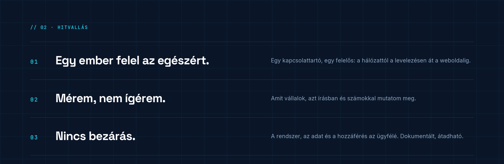
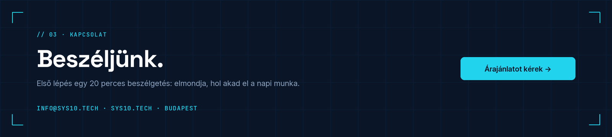

<a href="https://sys10.tech">
  <picture>
    <source media="(prefers-color-scheme: light)" srcset="assets/hero-light.png">
    
  </picture>
</a>

<picture>
  <source media="(prefers-color-scheme: light)" srcset="assets/pillars-light.png">
  
</picture>

<picture>
  <source media="(prefers-color-scheme: light)" srcset="assets/credo-light.png">
  
</picture>

<a href="https://sys10.tech">
  <picture>
    <source media="(prefers-color-scheme: light)" srcset="assets/cta-light.png">
    
  </picture>
</a>

 

<b>English</b>

 

**One person is accountable for all of it.** Sys10 Technologies is based in Budapest and works in three areas:

- **Helios:** our own application platform for simple web apps shaped around how a business works, such as customers, job sheets, stock, rentals and approvals. It runs on your own server or a cloud machine assigned to you, and the data stays yours.
- **Web development:** fast, custom-built websites, booking and quote flows, calculators and client portals.
- **IT operations:** Microsoft 365 or Google Workspace, devices, networks, email and backups, for a monthly fee with written response times and restores tested every quarter.

The first step is a 20-minute conversation: [info@sys10.tech](mailto:info@sys10.tech) · [sys10.tech](https://sys10.tech)

Biztonsági hibát a [biztonsági szabályzat](https://github.com/Sys10-Technologies/.github/blob/main/SECURITY.md) szerint jelezzen. · SYS10 TECHNOLOGIES · [sys10.tech](https://sys10.tech)
