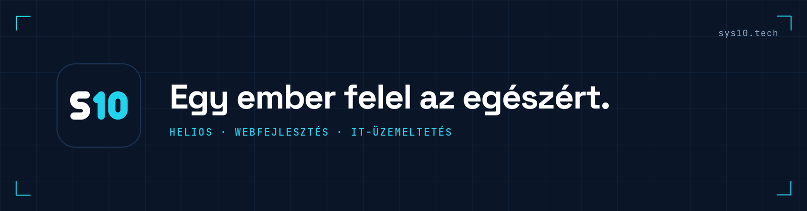

  

  <a href="https://sys10.tech">sys10.tech</a> · <a href="mailto:info@sys10.tech">info@sys10.tech</a> · Budapest 
  <b>Magyar</b> · <a href="#english">English</a>

## A céges folyamatai ne papíron és Excelben fussanak.

| | Pillér | Amit vállalok |
|---|---|---|
| `01` | **Helios** | Saját alkalmazásplatform, cégre szabott webes appokkal: ügyfélkezelés, munkalap, készlet, bérlés, jóváhagyás. Az Ön saját szerverén vagy egy Önhöz rendelt felhős gépen fut. Az adat az Öné. |
| `02` | **Webfejlesztés** | Gyors, saját kódbázisú weboldalak, foglalási és ajánlatkérő felületek, kalkulátorok, ügyfélportálok. Nem sablonból. |
| `03` | **IT-üzemeltetés** | Microsoft 365 vagy Google Workspace, gépek, hálózat, levelezés és mentés. Havidíjért, írásban vállalt reakcióidővel, negyedévente kipróbált visszaállítással. |

### Három mondat

- **Egy ember felel az egészért.** Egy kapcsolattartó, egy felelős.
- **Mérem, nem ígérem.** Amit vállalok, azt írásban és számokkal mutatom meg.
- **Nincs bezárás.** A rendszer, az adat és a hozzáférés az ügyfélé. Dokumentált, átadható.

### Beszéljünk.

Az első lépés egy 20 perces beszélgetés. Írjon az [info@sys10.tech](mailto:info@sys10.tech) címre, vagy keressen a [sys10.tech](https://sys10.tech) oldalon.

Biztonsági hibát a [biztonsági szabályzat](https://github.com/Sys10-Technologies/.github/blob/main/SECURITY.md) szerint jelezzen.

---

## Your business should not run on paper and Excel.

| | Pillar | What I take on |
|---|---|---|
| `01` | **Helios** | My own application platform, with simple web apps shaped around how your business works: customers, job sheets, stock, rentals, approvals. It runs on your own server or a cloud machine assigned to you. The data stays yours. |
| `02` | **Web development** | Fast, custom-built websites, booking and quote flows, calculators and client portals. No templates. |
| `03` | **IT operations** | Microsoft 365 or Google Workspace, devices, networks, email and backups. Monthly fee, written response times, restores tested every quarter. |

One named, accountable specialist in Budapest. The first step is a 20-minute conversation: [info@sys10.tech](mailto:info@sys10.tech) · [sys10.tech](https://sys10.tech)
