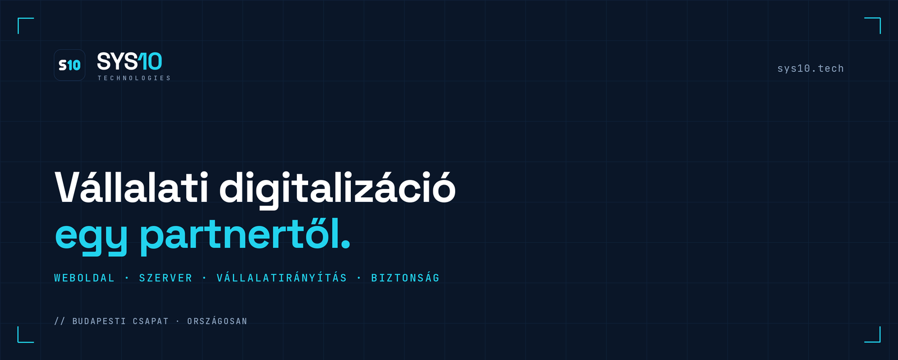
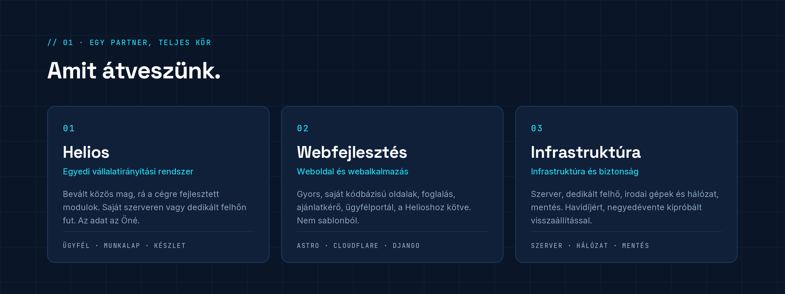

<a href="https://sys10.tech">
  <picture>
    <source media="(prefers-color-scheme: light)" srcset="assets/hero-light.png">
    
  </picture>
</a>

<picture>
  <source media="(prefers-color-scheme: light)" srcset="assets/pillars-light.png">
  
</picture>

<picture>
  <source media="(prefers-color-scheme: light)" srcset="assets/credo-light.png">
  
</picture>

<a href="https://sys10.tech">
  <picture>
    <source media="(prefers-color-scheme: light)" srcset="assets/cta-light.png">
    
  </picture>
</a>

 

<b>English</b>

 

**Business digitalisation from one partner.** Sys10 is an IT team in Budapest, working nationwide. We take over a company's whole IT:

- **Helios:** our own business management system: a proven shared core with modules built for your company, such as customers, job sheets, stock, rentals and purchasing. It runs on your own server or a dedicated cloud machine, and the data stays yours.
- **Websites and web apps:** fast, custom-built sites, booking and quote flows, calculators and client portals, connected to Helios.
- **Infrastructure and security:** servers, dedicated cloud, office computers and network, backup and protection, for a monthly fee with written response times and restores tested every quarter.

One partner is responsible for all of it.

The first step is a 20-minute conversation: [info@sys10.tech](mailto:info@sys10.tech) · [sys10.tech](https://sys10.tech)

Biztonsági hibát a [biztonsági szabályzat](https://github.com/Sys10-Technologies/.github/blob/main/SECURITY.md) szerint jelezzen. · SYS10 TECHNOLOGIES · [sys10.tech](https://sys10.tech)
